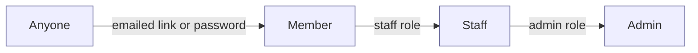
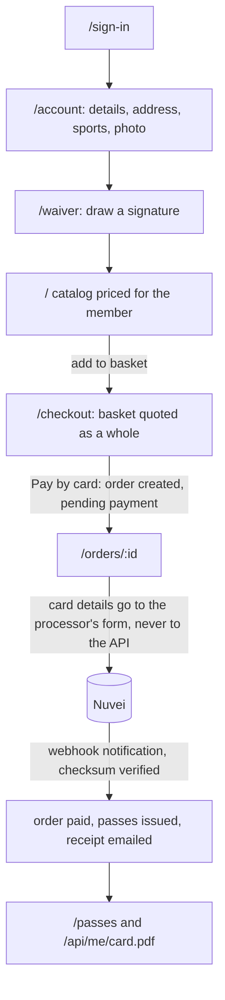
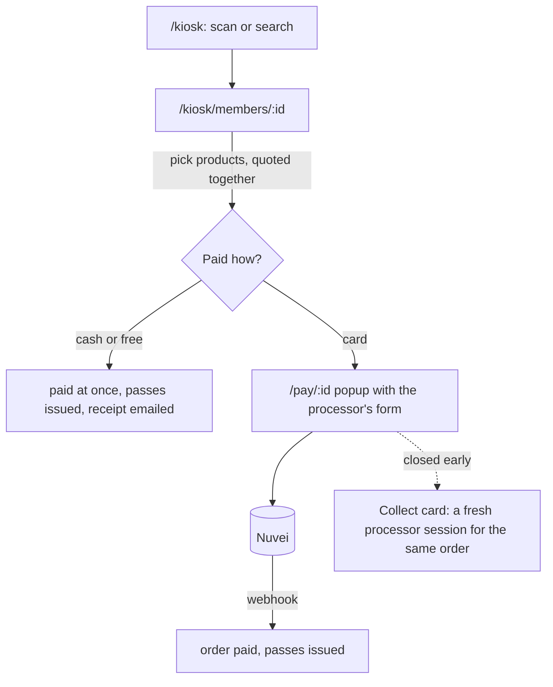
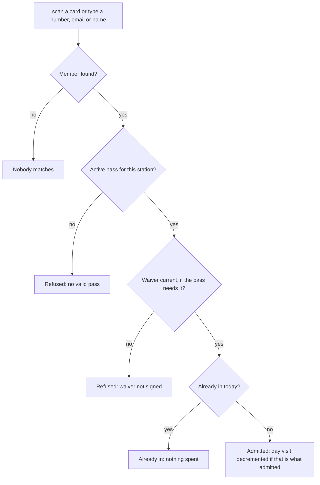
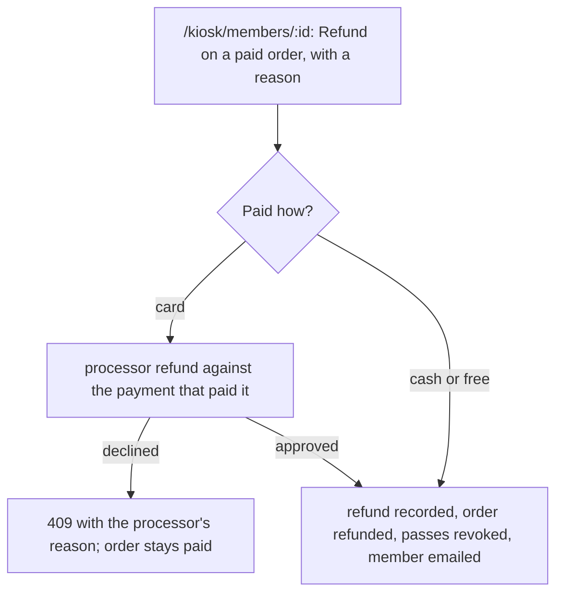

# Pages and permissions

Who can reach what, page by page, and how the main jobs flow through the
pages and the API. The API enforces every permission; the pages only hide
what a role cannot use. The route-by-route list is in [api.md](api.md).

## Roles

There are three roles on top of being signed in. Roles are rows on the
member; an admin grants and revokes them on the member page or with the
`grant_role` and `revoke_role` commands. Admin implies staff.

| Role | Can |
|---|---|
| Anyone | Sign in, request a sign-in link, read the API docs |
| Member | Keep their own profile, photo and password; see the catalog priced for them; buy with a card; see their orders, receipts and passes; download their card; sign the waiver |
| Staff | Everything a member can, plus the kiosk: find any member, check them in, take their photo, correct their profile, sell for cash, free or card, cancel an unpaid order, print cards |
| Admin | Everything staff can, plus set roles, refund a paid order, edit the catalog and roll it to a new season, publish and reset the waiver, run reports, and use Django's own admin site |

## Pages

| Page | Who | What it does | API it calls |
|---|---|---|---|
| `/sign-in` | anyone | Sign in with email and password, or ask for an emailed link. A link lands here with its token and signs in. | `/api/auth/password`, `/api/auth/request-link`, `/api/auth/redeem` |
| `/` Catalog | member | Products on sale today, priced for this member, with why any is locked. Adding to the basket counts as held, so a membership unlocks the passes that need it. | `/api/catalog` |
| `/checkout` Basket | member | The basket priced as a whole. Pay by card creates the order. | `/api/orders/quote`, `/api/orders` |
| `/orders/:id` Order | member | One order. While unpaid, the processor's card form (or, in development, an approve button); then the result. Polls until the webhook pays it. | `/api/orders/{id}`, `/api/orders/{id}/checkout`, `/api/orders/{id}/cancel` |
| `/orders` Orders | member | Orders awaiting payment (continue or cancel) and settled orders with receipts. | `/api/orders`, `/api/orders/{id}/receipt` |
| `/passes` My passes | member | What the member holds, and the card as a PDF. | `/api/entitlements`, `/api/me/card.pdf` |
| `/waiver` Waiver | member | The current waiver text, signed by drawing; a guardian also signs for a member under 18. | `/api/waiver`, `/api/waiver/sign` |
| `/account` Account | member | Contact details, address, sports, photo, password. | `/api/me/profile`, `/api/me/photo`, `/api/auth/set-password` |
| `/kiosk` Kiosk | staff | Scan a card or search; see passes and waiver status; check in at the Spit or the shuttle; take a photo; today's counts. | `/api/staff/kiosk/*`, `/api/staff/members/{id}/photo` |
| `/kiosk/members/:id` Member | staff | One member at the counter: profile to correct, passes, today's check-ins, the till (cash, free, card), orders with receipts, print card. Admins also set roles and refund. | `/api/staff/members/{id}`, `/api/staff/orders/*`, `/api/staff/cards/print`, `/api/admin/orders/{id}/refund` |
| `/pay/:id` Card payment | staff | The popup the till opens for a card sale, showing the processor's form to the member. | `/api/staff/orders/{id}`, `/api/staff/orders/{id}/checkout` |
| `/admin/catalog` | admin | Products, prices, grants and rules; roll a season forward. | `/api/admin/catalog/*` |
| `/admin/waiver` | admin | Publish a new waiver version, reset signatures, history. | `/api/admin/waiver/*` |
| `/admin/reports` | admin | Run any registered report, as a table or CSV. | `/api/admin/reports/*` |
| `/django-admin/` | admin | Django's own admin: look up members, orders, payments, refunds, waiver history. | (Django, not the JSON API) |
| `/api/docs` | anyone | The interactive API reference. | |

## Flows

### From first sign-in to a pass

Nothing can be bought until the profile is complete (photo, address, sports)
and the current waiver is signed. The catalog says which is missing and
links to the page that fixes it.

### A sale at the counter

### Check-in at the gate

One admission per member per station per day. A season pass is used before a
day visit is spent. A pass whose product requires the waiver admits only
while the member's signature is current.

### A refund

Whole order, admin only. Card money goes back through the processor; cash is
handed over at the counter and recorded.

### A new waiver version

Publishing a new version, or pressing reset, makes every signature stale.
Members are told on the catalog and at the gate, and sign again on
`/waiver`; nothing else is blocked for them.
